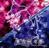
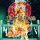
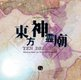
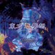
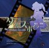
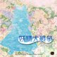
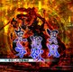

# 东方作品进度

## Windows 正作

|  |  | 还原 | 移植 | Web 适配 | 多人联机 |
| :---: | :---: | :---: | :---: | :---: | :---: |
|  | **[th06] 東方紅魔郷 v1.02h** | [GensokyoClub](https://github.com/GensokyoClub/th06/tree/master) ![Done][done] | [GensokyoClub](https://github.com/GensokyoClub/th06/tree/portable) ![Done][done] | [Ritosa2333](https://github.com/Ritosa2333/th06/tree/eagler) ![Done][done] | [Ritosa2333](https://github.com/Ritosa2333/th06/tree/eagler) ![Done][done] |
|  | **[th07] 東方妖々夢 v1.00b** | [some100](https://github.com/some100/th07/tree/main) ![Done][done] | [some100](https://github.com/some100/th07/tree/reallyportable) ![Done][done] | [Ritosa2333](https://github.com/Ritosa2333/th07/tree/eagler) ![Done][done] | [Ritosa2333](https://github.com/Ritosa2333/th07/tree/eagler) ![Done][done] |
|  | **[th08] 東方永夜抄 v1.00d** | [SteinsGateON](https://github.com/Ritosa2333/th08/tree/main) ![Done][done] | [SteinsGateON](https://github.com/Ritosa2333/th08/tree/main) ![Done][done] | [Ritosa2333](https://github.com/Ritosa2333/th08/tree/eagler) ![Done][done] | [Ritosa2333](https://github.com/Ritosa2333/th08/tree/experiment/th08-multiplayer) ![Done][done] |
|  | **[th09] 東方花映塚 v1.50a** | [SteinsGateON](https://github.com/Ritosa2333/th09/tree/main) ![Done][done] | [SteinsGateON](https://github.com/Ritosa2333/th09/tree/main) ![Done][done] | [Ritosa2333](https://github.com/Ritosa2333/th09/tree/eagler) [![In Progress][in-progress-detail]](#th09-web-适配) | [Ritosa2333](https://github.com/Ritosa2333/th09/tree/experiment/th09-multiplayer) ![Done][done] |
|  | **[th10] 東方風神録 v1.00a** | [SteinsGateON](https://github.com/Ritosa2333/th10/tree/main) ![Done][done] | [SteinsGateON](https://github.com/Ritosa2333/th10/tree/portable) ![Done][done] | [Ritosa2333](https://github.com/Ritosa2333/th10/tree/eagler) ![Done][done] | [Ritosa2333](https://github.com/Ritosa2333/th10/tree/experiment/th10-multiplayer) ![Done][done] |
|  | **[th11] 東方地霊殿 v1.00a** | [SteinsGateON](https://github.com/Ritosa2333/th11/tree/main) ![Done][done] | [SteinsGateON](https://github.com/Ritosa2333/th11/tree/main) ![Done][done] | [Ritosa2333](https://github.com/Ritosa2333/th11/tree/eagler) [![In Progress][in-progress-detail]](#th11-web-适配) | [Ritosa2333](https://github.com/Ritosa2333/th11/tree/eagler) [![In Progress][in-progress-detail]](#th11-多人联机) |
|  | **[th12] 東方星蓮船 v1.00b** | [Tweet-META](https://github.com/Tweet-META/th12/tree/main) ![Done][done] | [Tweet-META](https://github.com/Goan114/eagler-touhou/tree/main/ports/th12) ![Done][done] | [Tweet-META](../ports/th12/README.md) [![In Progress][in-progress-detail]](../ports/th12/ADAPTATION.md) | - |
|  | **[th13] 東方神霊廟 v1.00c** | [AgentMystia](https://github.com/AgentMystia) ![In Progress][in-progress] | - | - | - |
|  | **[th14] 東方輝針城 v1.00b** | [AdingApkgg/thp](https://github.com/AdingApkgg/thp) ![In Progress][in-progress] | [AdingApkgg/thp](https://github.com/AdingApkgg/thp) ![In Progress][in-progress] | [AdingApkgg/thp](https://github.com/AdingApkgg/thp) ![In Progress][in-progress] | - |
|  | **[th15] 東方紺珠伝 v1.00b** | [SteinsGateON](https://github.com/Ritosa2333/th15/tree/main) ![Done][done] | [SteinsGateON](https://github.com/Ritosa2333/th15/tree/main) ![Done][done] | [Ritosa2333](https://github.com/Ritosa2333/th15/tree/eagler) ![Done][done] | ![In Progress][in-progress] |
|  | **[th16] 東方天空璋 v1.00a** | ![Unassigned][unassigned] | - | - | - |
|  | **[th17] 東方鬼形獣 v1.00b** | SteinsGateON ![In Progress][in-progress] | SteinsGateON ![In Progress][in-progress] | - | - |
|  | **[th18] 東方虹龍洞 v1.00a** | [owo-aya](https://github.com/owo-aya) ![In Progress][in-progress] | - | - | - |
|  | **[th19] 東方獣王園 v1.10c** | [Idle](https://github.com/Idle233333) ![In Progress][in-progress] | - | - | - |
|  | **[th20] 東方錦上京 v1.00c** | [Oracatt](https://github.com/Oracatt/Touhou20/tree/main) ![Done][done] | [Ritosa2333](https://github.com/Ritosa2333/eagler-touhou/tree/main/ports/th20) ![Done][done] | 搁置 | - |

## 旧作（PC-98）

th01–th05 的移植、Web 适配与多人项目由 [IxinorTyan](https://github.com/IxinorTyan) 开发。

th01 的原生 C++ 核心同时提供 Windows 与 Web 版本。
th02–th05 的独立项目以 DOSBox-X PC-98 核心提供浏览器单机、合作与联机。
[NP2 浏览器合集](https://github.com/IxinorTyan/touhou-np2)另提供五作的单机入口。

|  |  | 还原 | 移植 | Web 适配 | 多人联机 |
| :---: | :---: | :---: | :---: | :---: | :---: |
|  | **[th01] 東方靈異伝** | [nmlgc](https://github.com/nmlgc/ReC98/tree/master/th01) ![Done][done] | [IxinorTyan](https://github.com/IxinorTyan/th01-multiorb-lab) ![Done][done] | [IxinorTyan](https://github.com/IxinorTyan/th01-multiorb-lab) ![Done][done] | [IxinorTyan](https://github.com/IxinorTyan/th01-multiorb-lab) ![In Progress][in-progress] |
|  | **[th02] 東方封魔録** | [nmlgc](https://github.com/nmlgc/ReC98/tree/master/th02) ![In Progress][in-progress] | - | [IxinorTyan](https://github.com/IxinorTyan/th02-coop-lab) ![Done][done] | [IxinorTyan](https://github.com/IxinorTyan/th02-coop-lab) ![In Progress][in-progress] |
|  | **[th03] 東方夢時空** | [nmlgc](https://github.com/nmlgc/ReC98/tree/master/th03) ![In Progress][in-progress] | - | [IxinorTyan](https://github.com/IxinorTyan/th03-netplay-lab) ![Done][done] | [IxinorTyan](https://github.com/IxinorTyan/th03-netplay-lab) ![In Progress][in-progress] |
|  | **[th04] 東方幻想郷** | [nmlgc](https://github.com/nmlgc/ReC98/tree/master/th04) ![In Progress][in-progress] | - | [IxinorTyan](https://github.com/IxinorTyan/th04-coop-lab) ![Done][done] | [IxinorTyan](https://github.com/IxinorTyan/th04-coop-lab) ![In Progress][in-progress] |
|  | **[th05] 東方怪綺談** | [nmlgc](https://github.com/nmlgc/ReC98/tree/master/th05) ![In Progress][in-progress] | - | [IxinorTyan](https://github.com/IxinorTyan/th05-coop-lab) ![Done][done] | [IxinorTyan](https://github.com/IxinorTyan/th05-coop-lab) ![In Progress][in-progress] |

## 小数点作

|  |  | 还原 | 移植 | Web 适配 | 多人联机 |
| :---: | :---: | :---: | :---: | :---: | :---: |
|  | **[th075] 東方萃夢想** | [SteinsGateON](https://space.bilibili.com/34714121) ![Done][done] | [SteinsGateON](https://github.com/YomotsuHisami/eagler-touhou/tree/main/ports/th075) ![Done][done] | [Goan114](https://github.com/YomotsuHisami/eagler-touhou/tree/main/ports/th075) ![In Progress][in-progress] | [Goan114](https://github.com/YomotsuHisami/eagler-touhou/tree/main/ports/th075-mp) ![In Progress][in-progress] |
|  | **[th095] 東方文花帖** | ![Unassigned][unassigned] | - | - | - |
|  | **[th105] 東方緋想天** | ![Unassigned][unassigned] | - | - | - |
|  | **[th123] 東方非想天則** | ![Unassigned][unassigned] | - | - | - |
|  | **[th125] ダブルスポイラー** | ![Unassigned][unassigned] | - | - | - |
|  | **[th128] 妖精大戦争** | ![Unassigned][unassigned] | - | - | - |
|  | **[th135] 東方心綺楼** | ![Unassigned][unassigned] | - | - | - |
|  | **[th143] 弾幕アマノジャク** | ![Unassigned][unassigned] | - | - | - |
|  | **[th145] 東方深秘録** | ![Unassigned][unassigned] | - | - | - |
|  | **[th155] 東方憑依華** | ![Unassigned][unassigned] | - | - | - |
|  | **[th165] 秘封ナイトメアダイアリー** | ![Unassigned][unassigned] | - | - | - |
|  | **[th175] 東方剛欲異聞** | ![Unassigned][unassigned] | - | - | - |
|  | **[th185] バレットフィリア達の闇市場** | ![Unassigned][unassigned] | - | - | - |

## 适配详情

## [th09] 東方花映塚 v1.50a

### th09 Web 适配

| 协议 | 高刷新率 | 触控 | 多语言 | thprac | Replay |
| :---: | :---: | :---: | :---: | :---: | :---: |
| ✅ | ❌ | ✅ | ✅ | ❌ | ✅ |

## [th11] 東方地霊殿 v1.00a

### th11 Web 适配

| 协议 | 高刷新率 | 触控 | 多语言 | thprac | Replay |
| :---: | :---: | :---: | :---: | :---: | :---: |
| ✅ | ❌ | ✅ | ✅ | ✅ | ✅ |

### th11 多人联机

| 规则 | 预测回滚 | 重开 | Replay | 旁观 |
| :---: | :---: | :---: | :---: | :---: |
| ✅ | ❌ | ✅ | ✅ | ✅ |

## [th14] 東方輝針城 v1.00b

- 维护与源码：[AdingApkgg/thp](https://github.com/AdingApkgg/thp)，当前源码 [5477b29](https://github.com/AdingApkgg/thp/commit/5477b29145628cb9762ad609644dad82b3f478cb)。
- 状态：还原／移植／Web 适配均进行中，仅推进 TH14，未完成整作 1:1。
- 已修复曲线激光生成原点和敌弹命中特效位移。魔理沙 A Hard 五面自然结束 75,921 回调，所列门槛通过，仍缺六面覆盖；灵梦 B Hard 完整 107,662 回调的有限门槛通过。
- 新修正原版 Scene 跨更新的相机交付窗口：只使用实际原指令边界和时间戳，不向引擎注入相机值。灵梦 A Hard 完整 96,103 回调的状态32字、相机25字、HUD2字、1,162个战斗检查点一致；原相机差消除，仍有6个effect149根worldZ字差，严格完整门槛继续失败。同诊断Wasm、同输入56,000回调A/B中，相机字差由933降至0。
- 新增灵梦 A Lunatic 原版自然结束86,751回调，观察到一至六面。所选状态、相机、HUD及1,133个战斗检查点一致，保留5个同类动画Z字差，未标为完整通过。336组合成栈原指令实验确认命中回调会读取未写栈Z；实际栈来源与任意外部干预仍未证明，不放宽原始差异门槛。
- 新增effect149家族完整有限生命周期组件：48组、三种时间步长及两种种子，原版实际工厂／全局动画更新／两个子对象直至家族销毁；除声明根Z外的4,224对原版完整VM字节及2,208对几何保持一致，X位移控制均改变几何。生产C++/Wasm的5,808边界、5,632行303字动画、2,944次几何及退休顺序一致。仅对照归一化分配环境下的对象身份，不声称原始句柄或完整回放通过。
- 此次调度修改后，咲夜 A Hard 完整96,682回调、动画2,020行／850个战斗检查点，以及灵梦 B Normal 完整122,537回调、动画2,586行／1,294个战斗检查点，通过独立原始字节复算。旧咲夜60,393回调退出记录继续保留为前缀，其退出原因未证明。
- 30组清单现为23组原版自然结束记录、19组观察到全部目标关卡入口；提前GameOver、通关与模式等价分别判断。其他相机、RNG和动画差异继续。实际原版存档21,633字节与解码149,076字节已有生产及原指令复核；普通菜单和浏览器持久化仍未验收。
- 当前生产图形未修改，实际浏览器仍为20／21场景全缓冲一致，保留三面单像素蓝119／120差。离屏裁剪／半像素偏移实验只用于定位，不作为WebGL已修复或实际浏览器验收。普通流程、所有模式、完整图像、原版PCM及持久化继续。
- 原始资产和内存不随源码发布；测试保持静音，维持100GiB空间和单次2GiB观察预算。
- 范围报告：[effect149有限生命周期](https://github.com/AdingApkgg/thp/blob/main/docs/porting/TH14_EFFECT149_RETIREMENT_OCT26.md)、[场景交付与保留差异](https://github.com/AdingApkgg/thp/blob/main/docs/porting/TH14_SCENE_HANDOFF_OCT26.md)、[模式清单](https://github.com/AdingApkgg/thp/blob/main/docs/porting/TH14_MODE_ACCEPTANCE_OCT25.md)、[剩余验收](https://github.com/AdingApkgg/thp/blob/main/docs/porting/TH14_REMAINING_ACCEPTANCE.md)。

## [th15] 東方紺珠伝 v1.00b

### th15 多人联机

| 规则 | 预测回滚 | 重开 | Replay | 旁观 |
| :---: | :---: | :---: | :---: | :---: |
| ❌ | ❌ | ❌ | ❌ | ❌ |

## 能力表样例

### Web 适配

| 协议 | 高刷新率 | 触控 | 多语言 | thprac | Replay |
| :---: | :---: | :---: | :---: | :---: | :---: |
| ✅ | ✅ | ✅ | ✅ | ✅ | ✅ |

### 多人联机

| 规则 | 预测回滚 | 重开 | Replay | 旁观 |
| :---: | :---: | :---: | :---: | :---: |
| ✅ | ✅ | ✅ | ✅ | ✅ |

## 图片来源

[THBWiki / 图片来源记录](../launcher/docs/assets/game-covers/sources.json)

[done]: https://img.shields.io/badge/Done-2ea44f?style=flat-square
[in-progress]: https://img.shields.io/badge/In%20Progress-f59e0b?style=flat-square
[in-progress-detail]: https://img.shields.io/badge/In%20Progress%20%28Click%20for%20detail%29-f59e0b?style=flat-square
[unassigned]: https://img.shields.io/badge/Unassigned-808080?style=flat-square
